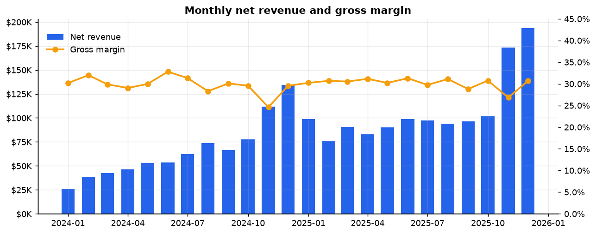
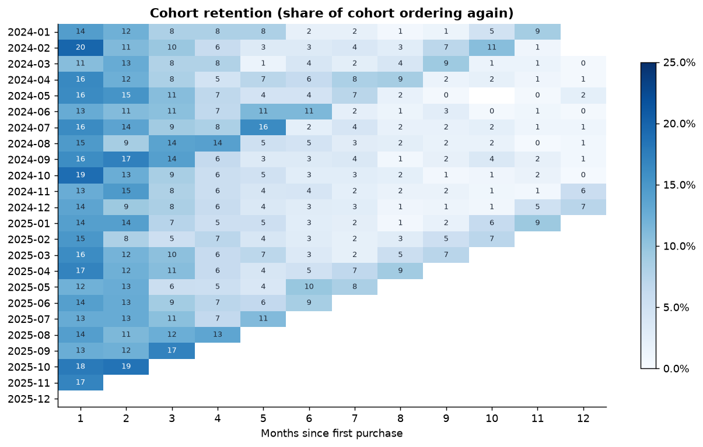

# E-commerce Sales & Customer Analytics

An end-to-end data analysis project for an online retailer: raw, messy data goes in; a cleaned SQL warehouse, business insights, recommendations and an interactive dashboard come out.

**Stack:** Python (pandas, NumPy), SQL (SQLite, CTEs and window functions), Matplotlib, Streamlit, pytest



## Business questions

1. How fast is the business growing, and how seasonal is it?
2. Which categories make money, not just revenue?
3. Which acquisition channels bring the most valuable customers?
4. Do discount codes pay for themselves?
5. How well do we keep customers, and who should we target to win back?

## Headline results (2024–2025)

| | |
|---|---|
| Net revenue | **$2.08M**, up **64.5%** year on year |
| Gross margin | **29.7%** |
| Biggest profit leak | Electronics: 45% of revenue, only 24% of profit |
| Best channel | Referral customers: **41% more profit** each than Social |
| Discounts | Cut gross margin from 32.1% to 20.9%, and baskets are *smaller* ($150 vs $181) |
| Win-back target | 963 "At Risk" customers who made 22% of historic revenue |

Full write-up with all 8 findings and 5 recommendations: **[reports/insights.md](reports/insights.md)**

## Pipeline

```
src/generate_data.py      raw CSVs (14k orders, 25k line items, 8k customers)
        │                 with real-world problems injected on purpose
        ▼
src/clean.py              dedupe, standardise text, parse mixed date formats,
        │                 fix prices stored as text, drop orphans/test orders
        │                 → data/processed/warehouse.db  + reports/data_quality.md
        ▼
sql/00_views.sql          semantic layer: one definition of GMV / net revenue / profit
sql/01-07_*.sql           KPIs, category scorecard, cohort retention, RFM,
        │                 channel LTV, discount impact, regional YoY
        ▼
src/analysis.py           runs the SQL, exports tables, draws charts,
        │                 writes reports/insights.md with data-driven numbers
        ▼
dashboard/app.py          Streamlit dashboard with date / category / region / channel filters
```

## Data cleaning

The raw export contains the problems a real one would: duplicate rows, `" north "` / `NORTH` / `north`, dates in both `2025-03-01` and `01/03/2025` format, prices like `"$1,234.00"`, negative quantities, ages of 999, missing product IDs and test orders. Every rule and how many rows it touched is logged in [reports/data_quality.md](reports/data_quality.md).

## SQL highlights

- **Cohort retention** ([03_cohort_retention.sql](sql/03_cohort_retention.sql)): first-purchase cohorts and months-since-first-order calculated in SQL.
- **RFM segmentation** ([04_rfm_segments.sql](sql/04_rfm_segments.sql)): `NTILE(5)` scoring for recency and monetary value, rule-based frequency scoring (most customers buy once, so quintiles would be meaningless), mapped to segments like Champions, At Risk and Hibernating.
- **Window functions:** `ROW_NUMBER()` to tell new orders from repeat orders, `SUM() OVER ()` for share-of-total.



## Quality checks

`pytest` runs 11 tests: unit tests for each cleaning rule, plus integrity checks on the built warehouse (unique keys, no orphan rows, valid values, and the views adding up to the base tables).

## How to run

```bash
python -m venv .venv && source .venv/bin/activate
pip install -r requirements.txt
python run_pipeline.py          # generate → clean → analyse (about 10 seconds)
pytest -q                       # 11 tests
streamlit run dashboard/app.py  # open http://localhost:8501
```

## Project structure

```
├── data/raw/              generated raw CSVs
├── data/processed/        SQLite warehouse (built by the pipeline)
├── sql/                   all business logic as SQL
├── src/                   generate → clean → analysis
├── dashboard/app.py       Streamlit app
├── reports/               insights.md, data_quality.md, figures/, tables/
├── tests/                 pytest suite
└── run_pipeline.py        one-command run
```

## Notes

The dataset is synthetic, generated with a fixed seed so results can be reproduced. It is built to behave like a real store: growth, holiday peaks, channel-specific repeat rates, category margins and return rates. To use real data, swap in the [UCI Online Retail II](https://archive.ics.uci.edu/dataset/502/online+retail+ii) or Olist dataset and map its columns in `src/clean.py`.
