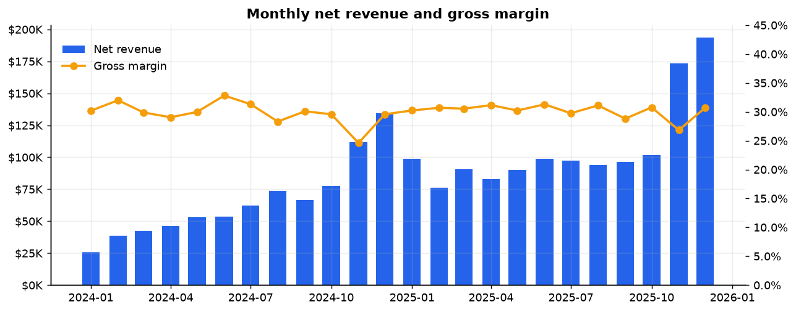
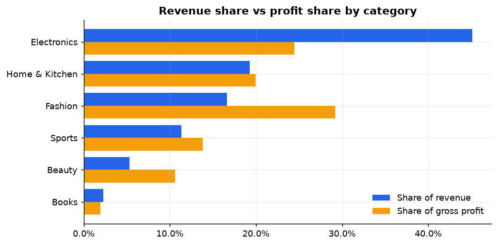
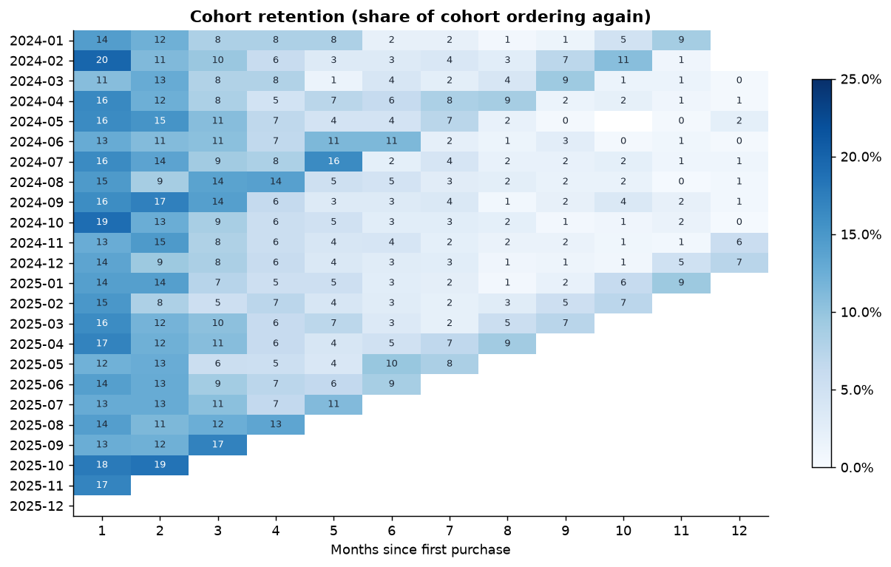
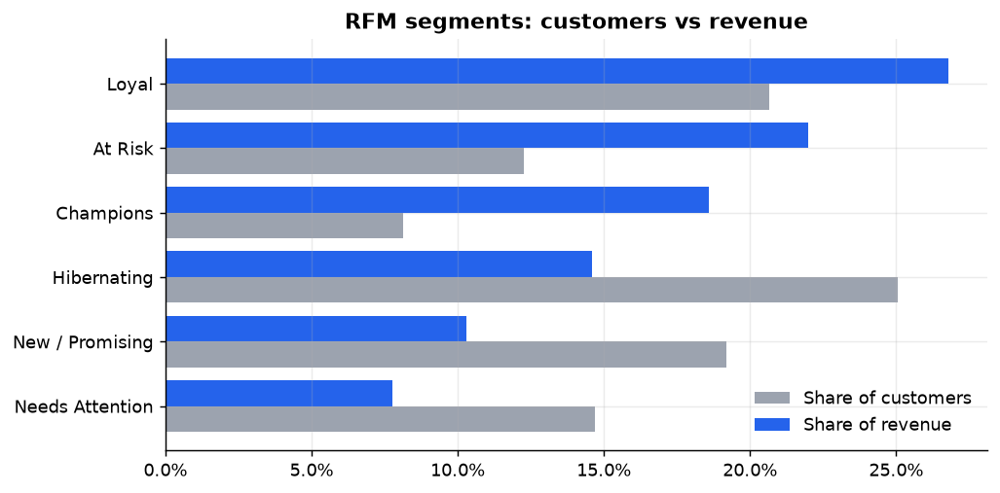
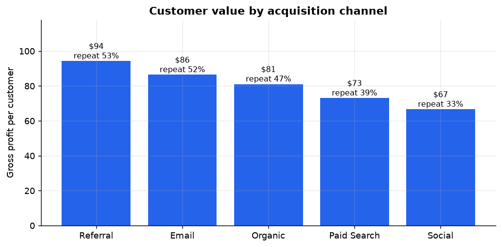

# Insights Report: Online Retail Performance 2024-2025

_All figures are generated by `src/analysis.py` from the cleaned warehouse._

## Headline numbers

| Metric | 2024 | 2025 |
|---|---:|---:|
| Net revenue | $786K | $1.29M |
| Gross profit | $230K | $388K |
| Orders | 5,097 | 8,829 |

Net revenue grew **64.5%** year on year. Over both years the business made $2.08M in net revenue at a 29.7% gross margin.

## Key findings

1. **Electronics drives revenue, not profit.** Electronics is 45% of revenue but only 24% of gross profit (margin 16.1%). Beauty has the best margin at 59.0%.
2. **Fashion has a returns problem.** 18.0% of Fashion order value is returned ($76K over two years), the highest of any category.
3. **Discounts cost margin and don't grow baskets.** Discounted orders have a 20.9% gross margin vs 32.1% at full price, and a lower average order value ($150 vs $181). Return rates are about the same.
4. **Holidays are the business.** November and December bring 29% of revenue, but November margin falls to 25.7% (vs 30.4% in other months) because of Black Friday codes.
5. **Channel quality varies a lot.** Referral customers are worth $94 gross profit each, 41% more than Social ($67). Repeat rates: 53% vs 33%.
6. **Most customers buy once.** 56% of customers have a single order. In the median cohort only 14.7% of customers order again the next month, and 9.1% in month 3.
7. **Revenue is concentrated.** Champions are 8% of customers but 19% of revenue. 'At Risk' customers (963 people, 22% of historic revenue) used to buy often and have gone quiet.
8. **Every region grew**, fastest in North (75%) and slowest in West (53%).

## Recommendations

| # | Recommendation | Why | How to measure |
|---|---|---|---|
| 1 | Shift paid budget from Social toward Referral and Email programmes | Referral customers are worth 41% more | Profit per acquired customer, by channel |
| 2 | Run a win-back campaign for the 963 At Risk customers | They hold 22% of historic revenue | Reactivation rate within 60 days |
| 3 | Replace blanket discount codes with targeted offers (e.g. second-order coupon) | Codes cut margin with no basket uplift | Margin and repeat rate of coupon users vs control |
| 4 | Investigate Fashion returns: size guides, better photos, fit reviews | Highest return rate | Return rate by product |
| 5 | Bundle high-margin accessories with Electronics | Lifts margin on the biggest category | Electronics attach rate and margin |

## Charts

## Caveats

- Lifetime value is *to date*: customers acquired late in 2025 have had less time to return.
- Discount analysis is observational; a controlled A/B test is needed to prove causality.
- The dataset is synthetic (see `src/generate_data.py`), built to mimic real e-commerce patterns.
